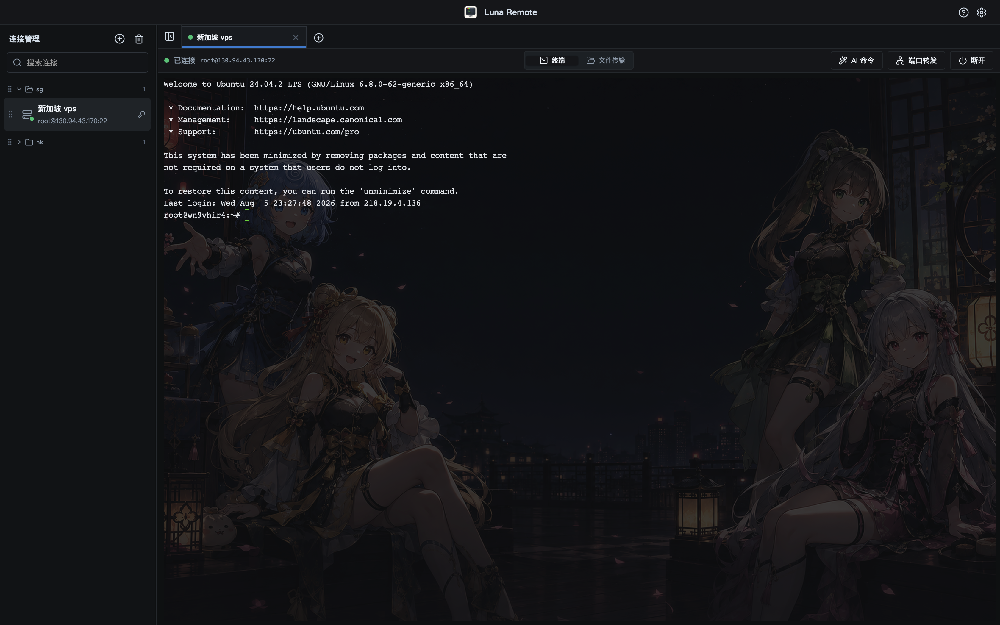
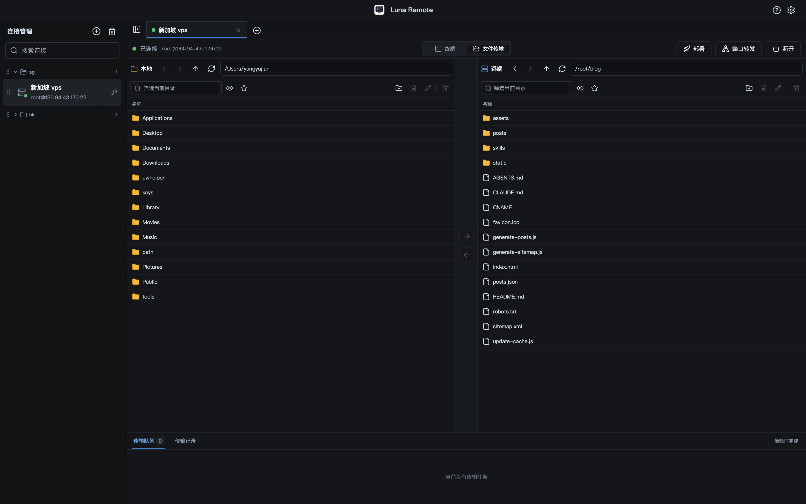
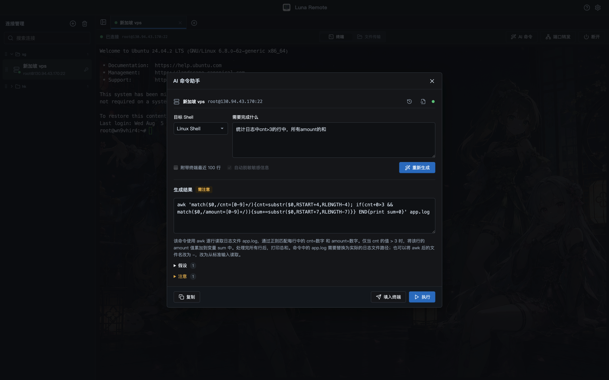

# Luna Remote

Luna Remote 是一款面向 macOS 和 Windows 的 SSH/SFTP 桌面客户端。它把终端、文件传输、端口转发和常用连接配置放在同一个窗口里，适合日常管理服务器和远程开发。

## SSH 终端

连接可以按分组整理，也可以为同一台机器同时打开多个独立会话。终端支持密码、键盘交互、私钥和 SSH Agent 认证，并提供 Host Key 校验、会话保活和一级跳板机。

终端字体、字号、配色、透明度和背景图均可调整。应用支持深色与浅色界面，也可以更换应用图标。

## SFTP 文件传输

本地目录和远程目录采用双栏布局，可以直接浏览、预览、上传和下载文件，也支持目录传输、拖放操作、路径收藏和传输冲突处理。

部署功能可以先比较本地与远程目录的差异，再批量上传需要更新的内容。

## AI 命令助手

AI 命令助手可以根据自然语言要求生成 Linux Shell、PowerShell、CMD 或 macOS 命令，并给出用途说明、假设条件和风险提示。生成结果可以复制、填入当前终端，确认后也可以直接执行。

它支持 OpenAI 兼容服务。需要附带终端上下文时，应用可以截取最近的输出，并对常见凭据和个人信息做脱敏处理。

## 更多功能

- macOS Keychain 与 Windows Credential Manager 安全凭据存储
- 本地、远程和 SOCKS5 动态端口转发
- SSH Config 导入
- 连接配置备份与恢复
- 文件预览、传输队列、失败重试和历史记录
- 可折叠、可排序的连接分组

## 开发

环境搭建、运行检查、打包发布和常见问题请查看 [开发文档](docs/DEVELOPMENT.md)。
